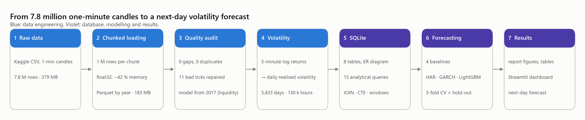
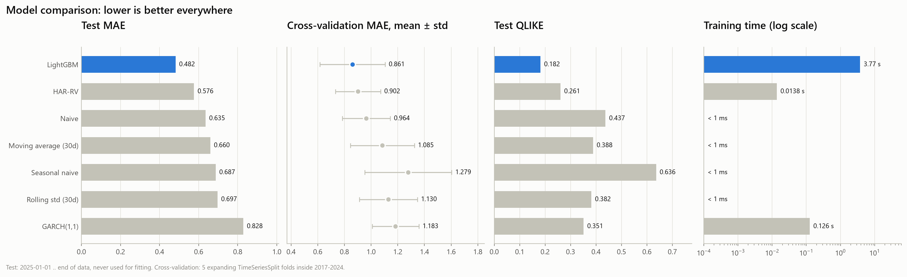
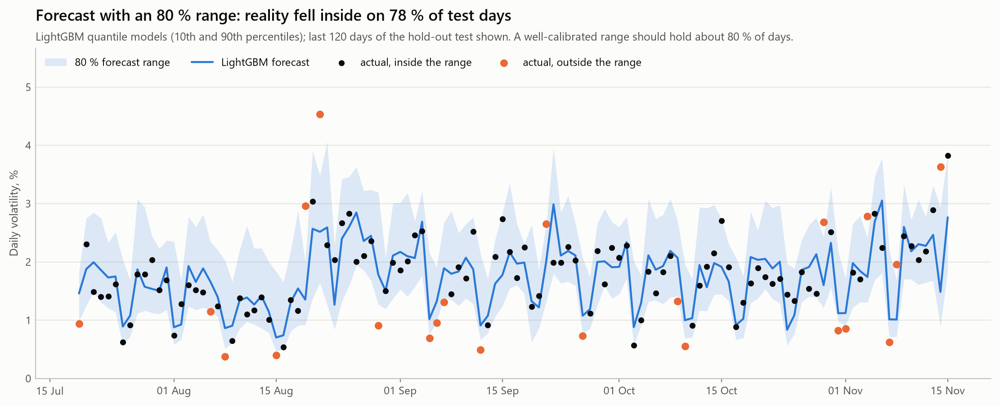
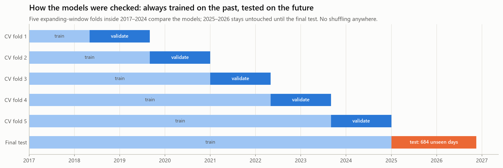
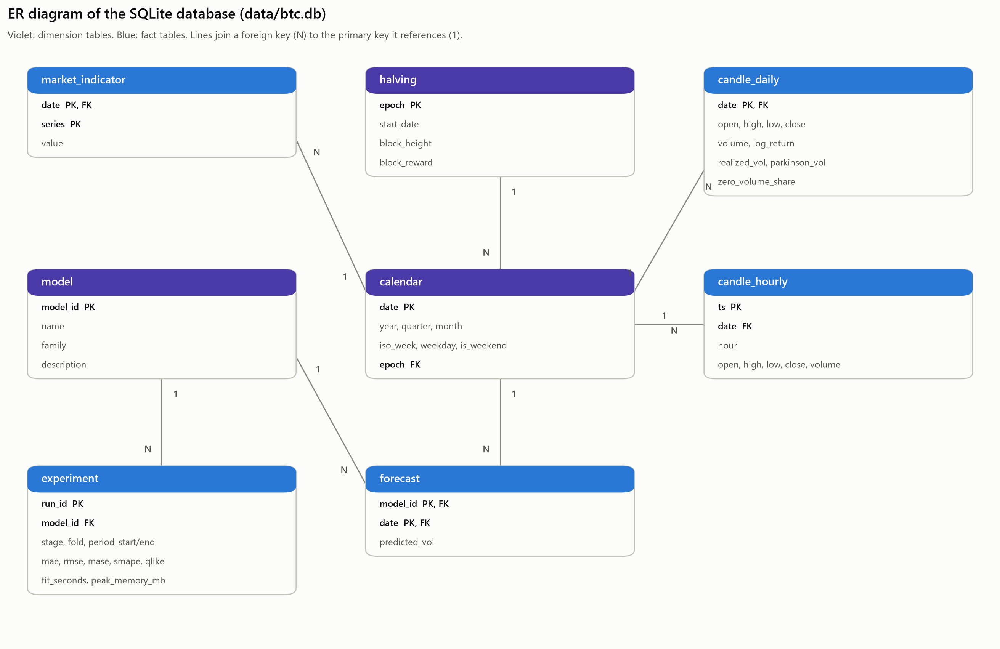

# Bitcoin Volatility Lab

**How volatile will Bitcoin be tomorrow?** This project processes 7.8 million one-minute
BTC/USD candles (2012–2026), measures daily *realised volatility* from 5-minute returns,
studies its patterns, stores everything in a normalised SQLite database and compares
four baselines with three forecasting models on a strictly chronological hold-out.

Final project for *Programming for Data Analysis and Database* (Applied AI, MSc),
topic 58 "Bitcoin Price and Volatility Analysis", cluster 10 "Forecasting & Open Data Analytics".
Team: Tanirbergenov Meirbek, Nurgozhiyev Aman, Bekzat Ashirbek (group AAI-2606M).
Repository: <https://github.com/meirshon999/btc-volatility>.

> Research project, not investment or trading advice.





## Key results

Hold-out test: 1 Jan 2025 – 15 Nov 2026 (684 days, never used for fitting). Target: next-day
realised volatility, % per day. MASE < 1 means better than the in-sample naive forecast.

| Model | Type | MAE | RMSE | MASE | QLIKE | MAE vs naive | Fit time |
|---|---|---:|---:|---:|---:|---:|---:|
| **LightGBM** | machine learning | **0.482** | **0.676** | **0.440** | **0.182** | **−24.2 %** | 3.8 s* |
| HAR-RV | econometric (linear regression on lags) | 0.576 | 0.801 | 0.526 | 0.261 | −9.3 % | 14 ms |
| Naive | baseline | 0.635 | 0.885 | 0.580 | 0.437 | — | < 1 ms |
| Moving average (30 d) | baseline | 0.660 | 0.937 | 0.603 | 0.388 | +3.8 % | < 1 ms |
| Seasonal naive (7 d) | baseline | 0.687 | 1.023 | 0.628 | 0.636 | +8.2 % | < 1 ms |
| Rolling std (30 d) of daily returns | baseline for GARCH | 0.697 | 0.979 | 0.637 | 0.382 | +9.7 % | < 1 ms |
| GARCH(1,1), Student-t | econometric | 0.828 | 1.034 | 0.757 | 0.351 | +30.4 % | 0.13 s |

\* including the nested hyper-parameter search and the two quantile models of the 80 % range.
Fit times vary slightly between runs; the quality metrics are identical on every run.

* LightGBM and HAR-RV beat the naive forecast significantly for absolute, squared and QLIKE
  loss (Diebold–Mariano, p < 0.001); the top three are the same, in the same order, in 5-fold
  time-series cross-validation inside 2017–2024 (LightGBM 0.861 ± 0.244, HAR-RV 0.902 ± 0.170,
  naive 0.964 ± 0.180).
* **GARCH vs rolling std** (the topic's question; both use only daily returns): the rolling
  standard deviation has the lower MAE (0.697 vs 0.828, Diebold–Mariano p < 0.001), GARCH the
  lower QLIKE (0.351 vs 0.382, not significant, p = 0.13). GARCH reacts faster after shocks
  (MAE on high-volatility days 1.50 vs 2.12) but over-predicts calm days. HAR-RV and LightGBM,
  which also use intraday (5-minute) volatility, beat both.
* The gain comes from calm and normal days: on the most turbulent third of days no model
  is better than the naive forecast (see `reports/figures/12_error_by_regime.png`).
* **Uncertainty is honest:** LightGBM quantile models give an 80 % forecast range; on the test
  period the actual volatility fell inside it on 78.2 % of days (13.9 % below the range,
  7.9 % above: like the point forecasts, the range is a little too high on calm days).
  For 16 Nov 2026 the forecast is 3.56 % per day, 80 % range 2.41–4.35 %.



Findings from the exploratory analysis (2017 onward):

| Hypothesis | Test | Result |
|---|---|---|
| H1. Volatility is lower on weekends | Mann–Whitney U | confirmed, p < 0.001: median 2.17 % vs 2.83 %; STL: Saturday −25 %, Sunday −14 % |
| H2. Volatility clusters | Ljung–Box on squared returns | confirmed, p < 0.001 |
| H3. A fall today raises tomorrow's volatility (leverage effect) | Spearman | not confirmed, p = 0.26 |
| H4. BTC volatility moves with the VIX | Spearman, rolling correlation | unstable: −0.24 in 2017–19, +0.14 in 2023–26, rolling 1-year correlation between −0.36 and +0.49 |

Data processing (requirement 9 and cluster 10):

| Reading 7.8 M minute rows | Time (best of 3) | Extra peak memory | On disk |
|---|---:|---:|---:|
| CSV, default dtypes (baseline) | 0.44 s | 1 101 MB | 379 MB |
| CSV, compact dtypes (float32) | 0.46 s | 661 MB | 379 MB |
| CSV in chunks of 1 M rows | 0.79 s | 43 MB | 379 MB |
| Parquet, all columns | 0.12 s | 676 MB | 183 MB |
| Parquet, 2 columns | 0.07 s | 280 MB | 183 MB |
| Parquet, one year (partition pruning) | 0.01 s | 58 MB | 12 MB |

Compact dtypes cut the DataFrame from 358 MB to 209 MB (−42 %); the largest float32 rounding
error of a price is 5.7·10⁻⁸ (relative), far below a typical 5-minute return. The same three
aggregations in pandas and SQLite give identical results; pandas is 1.3–54× faster in memory,
SQLite keeps the data persistent and queryable. Timings differ between machines and runs; the
latest values are in `reports/tables/benchmark_*.csv`.

## Dataset

* **Bitcoin Historical Data**, Bitstamp BTC/USD one-minute OHLCV candles since 2012:
  <https://www.kaggle.com/datasets/mczielinski/bitcoin-historical-data> (file
  `btcusd_1-min_data.csv`, 379 MB; columns `Timestamp, Open, High, Low, Close, Volume`).
  The report uses 7 823 519 rows: 1 Jan 2012 00:01 – 15 Nov 2026 23:59 UTC.
  The file is not stored in the repository; see "How to run".
* **FRED** (optional, downloaded automatically): VIX (`VIXCLS`), S&P 500 (`SP500`), broad
  U.S. dollar index (`DTWEXBGS`). Used only in the correlation analysis, never as model
  inputs, so the pipeline also runs offline.

## How to run

Requirements: Python 3.11 or newer (pandas 3 needs it; the project was tested with Python 3.14
on Windows 11), about 2 GB of free RAM and 1.5 GB of disk space (libraries ≈ 0.7 GB, data ≈ 0.6 GB).

First download `btcusd_1-min_data.csv` from Kaggle and put it into `data/raw/`. The file is
updated daily; `DATA_END = "2026-11-15"` in `src/config.py` cuts it at the last day used in
this report, so all numbers reproduce exactly (set it to `None` to analyse the newest data).

### Quick start: one click

* **Windows:** double-click `start.bat`.
* **macOS / Linux:** `./start.sh` (once: `chmod +x start.sh`).

The first start creates the Python environment and installs the libraries (3–5 minutes),
computes everything (1–2 minutes) and opens the dashboard in the browser. Later starts open it
in a few seconds. If the dataset is missing, the launcher says where to put it.
Inside an existing environment `python start.py` does the same (`--rebuild` recomputes
everything, `--no-dashboard` only prepares).

### Step by step

```bash
python -m venv .venv
# Windows: .venv\Scripts\activate      macOS / Linux: source .venv/bin/activate
pip install -r requirements.txt
python main.py --all        # the whole pipeline, about 1-2 minutes
streamlit run app.py        # the dashboard
python main.py              # the interactive console menu (Windows: run_menu.bat)
python -m pytest            # the tests
```

Google Colab should work the same way (upload the CSV to `data/raw/`, then
`!pip install -r requirements.txt` and `!python main.py --all`), but we have not tested it there.

### Console menu

```
  Dataset: found (btcusd_1-min_data.csv)   Database: ready   Models: trained (best: LightGBM)

  DATA
    1  Load the raw CSV          1 M-row chunks -> Parquet by year              done 13:11
    2  Check data quality        gaps, duplicates, bad ticks                    done 13:11
    3  Measure volatility        daily realised volatility from 5-min returns   done 13:11
    4  Download market data      VIX, S&P 500, dollar index (optional)          done 13:11
  DATABASE
    5  Build the database        SQLite, 8 tables                               done 13:11
    6  Run SQL queries           15 queries, choose a period
  ANALYSIS AND MODELS
    7  Explore the data          statistics, seasonality, hypothesis tests      done 13:11
    8  Train and compare models  7 models, cross-validation, hold-out test      done 13:11
    9  Speed and memory tests    CSV vs Parquet, pandas vs SQLite               done 13:11
  RESULTS
   10  Draw the figures          18 report figures + 2 interactive charts       done 13:13
   11  Forecasts for a date      what each model predicted vs reality
   12  Open the dashboard        interactive charts in the browser
  ALL AT ONCE
   13  Run everything            steps 1-5 and 7-10, about 1-2 minutes

    0  Exit
```

The status line shows whether the dataset, database and models are ready; "done" marks
finished steps (saved in `reports/pipeline_state.json`). Every step checks its inputs and
names the step to run first; wrong input (an unknown number, an invalid date) is explained
instead of crashing the program.

### Dashboard

Written for people who do not know the topic: every chart has a one-line *How to read* and
*Takeaway*, and a **Glossary** button explains the terms. Filters (period presets — 1 year,
3 years, since 2017, all, custom — halving epochs, price scale, rolling window, models) apply
to all seven tabs:

| Tab | What it answers |
|---|---|
| **Overview** | "How much will Bitcoin move tomorrow?" in % and in dollars, with the 80 % range; a calm / normal / stormy indicator; four key findings; the last 60 days of forecasts |
| **Market** | price and volume with halvings and numbered market shocks (hover for the day's move), return distribution, yearly and halving-epoch summaries from SQL |
| **Volatility** | rolling volatility, a GitHub-style volatility calendar for any year, weekday and hour-of-day patterns, correlations with the VIX and the S&P 500 |
| **Forecasts** | forecasts with the 80 % range, zoom buttons, **"look at one day"** (what happened, what the models saw, how close each model came), accuracy for the selected window |
| **Models** | "how much better than naive", the validation timeline, metrics, monthly errors, cross-validation, Diebold–Mariano tests, errors by regime, feature importance |
| **SQL explorer** | every named query with the period as parameters, CSV download, own read-only queries |
| **Data & performance** | pipeline diagram, quality audit, storage and engine benchmarks, ER diagram |

Light and dark themes follow the system setting; charts switch with them.

## Project structure

```
btc-volatility/
├── start.bat / start.sh one-click start (environment, pipeline, dashboard)
├── start.py             the logic behind the one-click start
├── main.py              console menu and pipeline runner
├── app.py               Streamlit dashboard
├── requirements.txt
├── src/
│   ├── config.py        paths, periods, halving dates, constants
│   ├── loader.py        chunked CSV -> year-partitioned Parquet, dtype optimisation
│   ├── quality.py       data quality audit and cleaning rules
│   ├── features.py      resampling, realised volatility, model features, splits
│   ├── external.py      FRED download (with retries) and loading
│   ├── database.py      SQLite schema loading, named queries -> pandas
│   ├── eda.py           statistics, IQR outliers, ADF/KPSS, STL, ACF/PACF, hypotheses
│   ├── models.py        Naive, Seasonal naive, Moving average, Rolling std, HAR-RV, GARCH, LightGBM
│   ├── evaluate.py      metrics, TimeSeriesSplit CV, hold-out test, DM test, error analysis
│   ├── experiment.py    the full modelling experiment and next-day forecast
│   ├── benchmark.py     CSV vs Parquet, pandas vs SQLite (time, memory, equality)
│   ├── plots.py         report figures (matplotlib)
│   ├── charts.py        interactive figures (Plotly)
│   ├── style.py         one colour-blind-safe visual style for both
│   ├── launcher.py      starts the dashboard on a free port and opens the browser
│   └── utils.py         timing, memory, JSON, pipeline state
├── sql/schema.sql       normalised schema (8 tables)
├── sql/queries.sql      15 named analytical queries
├── tests/               32 pytest tests, including look-ahead (leakage) checks
├── reports/             figures, result tables (CSV) and JSON summaries
└── data/                raw CSV, Parquet, processed tables, btc.db (not in git)
```

## Methods

**Loading and memory.** The CSV is read in chunks of 1 M rows; each chunk is converted to
`datetime64` + `float32` and written to Parquet partitioned by year (`data/parquet/minute/year=YYYY`).
Later steps read one year at a time, so the full dataset never has to be in memory.

**Data quality audit** (`reports/quality_report.json`). The minute grid is complete (no missing
minutes, duplicates, NaN or impossible candles). Two real issues were found and handled:
* *Stale prices before 2017*: 24–95 % of minutes had no trade (the price is simply repeated),
  which pushes measured volatility towards zero. In 2017 the share is 8.0 %, from 2018 on below
  4 % (0.3 % in 2026), so modelling starts on 1 Jan 2017 (rule: every following year ≤ 15 %).
* *11 bad ticks in 2013*: one-minute jumps of more than 10 % that reversed in the next minute
  (e.g. 140 → 75 → 139 USD). They are replaced by the previous close; genuine crashes,
  which do not revert, are kept. Daily-return IQR outliers (8.7 % of days) are kept as well:
  bad ticks were already removed at the minute level, and the large moves are what volatility
  models must learn.

**Realised volatility.** RV of a day = √Σ r², where r are the 288 five-minute log returns
of that UTC day (5-minute sampling limits microstructure noise). If the data end in the
middle of a day, that incomplete day is dropped.

**Market events.** Five well-known shocks are marked on the charts (COVID crash 12 Mar 2020,
China crypto crackdown 19 May 2021, Terra/LUNA 12 May 2022, FTX 8 Nov 2022, U.S. spot ETF
approval 10 Jan 2024). They are annotations only; each date was checked against the data and
lies in the top 17 % of daily volatility since 2017 (four of the five in the top 3 %).

**Time series analysis.** Resampling to 5 min / 1 h / 1 day, rolling means, robust STL with
a weekly period (seasonal strength 0.34), ADF and KPSS tests (log price: unit root; returns:
stationary; log volatility: the tests disagree — mean-reverting but highly persistent, a sign
of long memory), ACF/PACF (squared returns and log volatility are strongly autocorrelated,
returns are not).

**Models.** All forecast day *t* with information up to day *t−1*.
* Baselines: naive (yesterday), seasonal naive (same weekday last week), 30-day moving average
  of realised volatility, and the 30-day rolling standard deviation of daily returns — the
  classic benchmark for GARCH, built from exactly the same information (daily returns only).
* HAR-RV (Corsi, 2009): linear regression of log volatility on its daily, weekly (5-day) and
  monthly (22-day) averages, back-transformed with Duan's smearing correction.
* GARCH(1,1) with Student-t errors on daily returns (`arch`), parameters estimated on the
  training period and then only filtered forward.
* LightGBM on 19 features (volatility lags 1–7 and their averages, previous-day returns, range-based
  volatility, volume, weekday, days since the halving); hyper-parameters chosen with an inner
  TimeSeriesSplit (nested, so the outer evaluation stays honest). Two extra LightGBM models
  trained with the quantile (pinball) loss give the 10th and 90th percentiles: the 80 % range.

**Validation without leakage.** Train 2017-01-01 … 2024-12-31 (2 922 days), test 2025-01-01 …
2026-11-15 (684 days); 5-fold expanding `TimeSeriesSplit` inside the training period; no
shuffling anywhere. `tests/test_no_leakage.py` changes the data after a cut-off day and checks
that no forecast (and no forecast range) up to that day changes — for all seven models.



**Metrics.** MAE, RMSE, sMAPE, MASE (scaled by the in-sample naive MAE) and QLIKE (on variances,
robust to noise in the realised measure, Patton 2011), plus training time, peak memory and model
size. Diebold–Mariano tests for absolute, squared and QLIKE loss (Harvey–Leybourne–Newbold
correction) check whether differences
are significant. Error analysis: by month, by volatility regime (thresholds from training-period
terciles), by weekday, and the ten largest errors.

## Database



Dimension tables `halving`, `calendar`, `model`; fact tables `candle_daily`, `candle_hourly`,
`market_indicator` (long format), `experiment`, `forecast`. Actual values are not duplicated in
`forecast`; they are joined from `candle_daily`. Foreign keys are enforced.

| Query (`sql/queries.sql`) | SQL features |
|---|---|
| `yearly_summary` | JOIN, GROUP BY, HAVING |
| `halving_epochs` | CTE, FIRST_VALUE / LAST_VALUE window, JOIN |
| `rolling_volatility` | CTE, AVG() OVER (ROWS BETWEEN …) |
| `max_drawdown_by_year` | running MAX() OVER, ROW_NUMBER() OVER (PARTITION BY …) |
| `top_volatile_days` | CTE, ROW_NUMBER() partitioned by year |
| `intraday_profile` | LAG() window, JOIN, GROUP BY |
| `weekend_effect` | CASE, GROUP BY, HAVING |
| `turbulent_months` | scalar subquery in HAVING |
| `completeness_by_year` | LEFT JOIN, CTE, COALESCE |
| `model_leaderboard` | CTE, subquery, RANK() |
| `cv_stability` | GROUP BY, HAVING, variance |
| `monthly_winners` | JOIN of three tables, two CTEs, RANK() OVER (PARTITION BY month), GROUP_CONCAT |
| `forecast_errors_by_month` | JOIN, GROUP BY |
| `market_alignment` | LEFT JOIN on a long table with conditions |
| `next_day_forecast` | anti-join (LEFT JOIN … IS NULL) |

All queries are loaded into pandas through `src.database.run_query(name, params)`; their
results feed the analysis (e.g. the intraday heat-map and the dashboard tables).

## Where each course requirement is met

| # | Requirement | Where |
|---|---|---|
| 1 | ≥ 5 functions | about 200 functions and methods in 16 modules of `src/` plus `main.py`, `app.py`, `start.py` |
| 2 | lists and dicts | `config.HALVINGS`, menu `STEPS`, statistics dictionaries, result lists |
| 3 | if / elif / else | cleaning rules, stationarity verdict, menu, model logic |
| 4 | loops | chunk loop, year-by-year processing, CV folds, menu `while` loops |
| 5 | files | CSV → Parquet, JSON and CSV reports, `pipeline_state.json`, joblib models |
| 6 | try / except | menu (`FileNotFoundError`, invalid input `ValueError`), downloads (`URLError`, retries), dashboard SQL |
| 7 | user interface | console menu `main.py` and Streamlit dashboard `app.py` |
| 8 | modularity, standard library | `src/` package; `pathlib`, `json`, `datetime`, `argparse`, `sqlite3`, `urllib`, `subprocess`, `tracemalloc`, `re` |
| 9 | ≥ 2 approaches + baseline | CSV vs Parquet; pandas vs SQL; 4 baselines vs HAR-RV, GARCH, LightGBM (quality, time, memory) |
| 10 | database and SQL | SQLite, ER diagram, 15 queries with JOIN, GROUP BY/HAVING, subqueries, CTE, window functions → pandas |
| 11 | ≥ 500 K rows / 200 MB | 7.8 M rows, 379 MB; chunks, float32, partitioned Parquet with measurements |
| C10 | cluster tasks | resample, rolling, STL, ADF/KPSS, ACF/PACF, naive + seasonal naive, 3 models, MAE/RMSE/sMAPE/MASE, TimeSeriesSplit, error analysis, Plotly, external factors, Streamlit, results in SQLite/Parquet |

## Limitations

* One exchange (Bitstamp); volatility on other venues and in derivatives may differ.
* Realised volatility is itself an estimate; 5-minute sampling ignores intra-interval moves.
* GARCH is fitted to close-to-close returns, so it measures a slightly different quantity.
* Peak memory of model fitting is measured with `tracemalloc` (Python/NumPy allocations only);
  the storage benchmark measures real process memory in separate processes.
* No model predicts sudden shocks: on the most turbulent days all forecasts are too low.

## Team

Group AAI-2606M.

| Member | Area of responsibility (presents it and answers questions on it) |
|---|---|
| Tanirbergenov Meirbek | Project lead; forecasting models, evaluation and results (`models.py`, `evaluate.py`, `experiment.py`) |
| Nurgozhiyev Aman | Data engineering and database: loading, Parquet, quality audit, realised volatility, SQLite and SQL (`loader.py`, `quality.py`, `features.py`, `database.py`, `sql/`) |
| Bekzat Ashirbek | Exploratory analysis, figures and user interfaces (`eda.py`, `plots.py`, `charts.py`, `app.py`, `main.py`) |

## References

* Andersen, Bollerslev, Diebold, Labys (2003). Modeling and forecasting realized volatility. *Econometrica*.
* Corsi (2009). A simple approximate long-memory model of realized volatility. *Journal of Financial Econometrics*.
* Bollerslev (1986). Generalized autoregressive conditional heteroskedasticity. *Journal of Econometrics*.
* Patton (2011). Volatility forecast comparison using imperfect volatility proxies. *Journal of Econometrics*.
* Diebold, Mariano (1995). Comparing predictive accuracy. *Journal of Business & Economic Statistics*.
* Cleveland et al. (1990). STL: a seasonal-trend decomposition procedure based on loess. *Journal of Official Statistics*.
* Duan (1983). Smearing estimate: a nonparametric retransformation method. *Journal of the American Statistical Association*.
* Harvey, Leybourne, Newbold (1997). Testing the equality of prediction mean squared errors. *International Journal of Forecasting*.
* Ke et al. (2017). LightGBM: a highly efficient gradient boosting decision tree. *Advances in Neural Information Processing Systems*.
* Parkinson (1980). The extreme value method for estimating the variance of the rate of return. *Journal of Business*.
